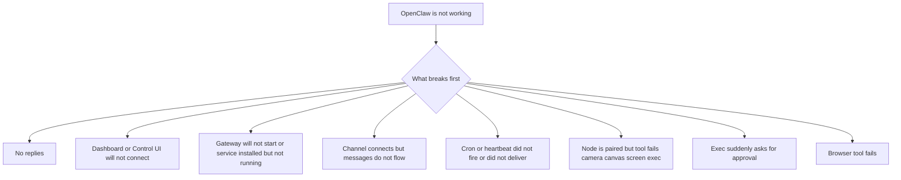
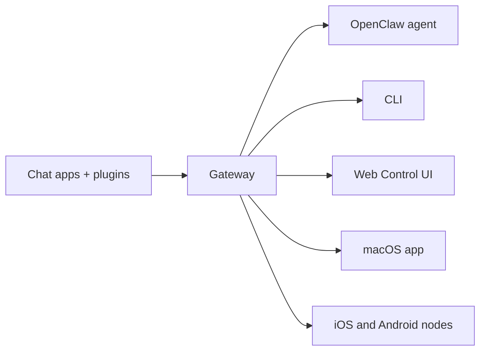

# General troubleshooting
Source: https://docs.openclaw.ai/help/troubleshooting

Triage front door. 2 minutes to a diagnosis, then jump to the deep page.

For official OpenClaw support, visit [community.openclaw.ai](https://community.openclaw.ai/). See [Get support](/help/support) for safe diagnostics and separate bug and security reporting routes.

## First 60 seconds

Run this ladder in order:

```bash
openclaw triage
openclaw status
openclaw status --all
openclaw gateway probe
openclaw gateway status
openclaw doctor
openclaw channels status --probe
openclaw logs --follow
```

Good output, one line each:

- `openclaw triage` writes a sanitized, agent-ready diagnosis and, when the Gateway is reachable, a support archive. See [Triage](/cli/triage) for agent handoff options.
- `openclaw status` shows configured channels, no auth errors.
- `openclaw status --all` produces a full, shareable report.
- `openclaw gateway probe` shows `Reachable: yes`. `Capability: ...` is the
  auth level the check proved. Missing `operator.read` scope limits read diagnostics; it does not mean the connection failed.
- `openclaw gateway status` shows `Runtime: running`, a successful connectivity check, and a plausible `Capability: ...`. Add `--require-rpc` to also require
  read-scope RPC proof.
- `openclaw doctor` reports no blocking config/service errors.
- `openclaw channels status --probe` returns live per-account transport state
  (`works` / `audit ok`) when the gateway is reachable; falls back to
  config-only summaries when it is not.
- `openclaw logs --follow` shows steady activity, no repeating fatal errors.

## Assistant feels limited or missing tools

Check the effective tool profile:

```bash
openclaw status
openclaw status --all
openclaw doctor
```

Common causes:

- `tools.profile: "minimal"` allows `session_status` and `gateway` maintenance (`update.run`, `restart`, and `update.cleanup`), but not configuration reads.
- `tools.profile: "messaging"` is narrow, for chat-only agents.
- `tools.profile: "coding"` selects repo, file, shell, and runtime work.
- `tools.profile: "full"` is the local onboarding default. It removes core profile
  filtering and selects optional plugin tools, subject to independent restrictions.
- An unset profile leaves core tools unfiltered but does not itself select optional
  plugin tools. Existing configs stay unchanged unless onboarding is run again.
- Per-agent `agents.entries.*.tools` overrides narrow or expand the root profile
  for one agent.

Change the profile, restart or reload the Gateway, then recheck with
`openclaw status --all`. Check the chat **Permissions** menu separately;
Full tool selection does not grant **Full access** or configure missing plugins.
Full profile/group table: [Tool profiles](/gateway/config-tools/tool-policy#tool-profiles).

## Anthropic long context 429

`HTTP 429: rate_limit_error: Extra usage is required for long context requests`
→ [Anthropic 429 extra usage required for long context](/gateway/troubleshooting#anthropic-429-extra-usage-required-for-long-context).

## Local OpenAI-compatible backend works directly but fails in OpenClaw

Your local/self-hosted `/v1` backend answers direct `/v1/chat/completions`
checks but fails on `openclaw infer model run` or normal agent turns:

1. Error mentions `messages[].content` expecting a string: set
   `models.providers.<provider>.models[].compat.requiresStringContent: true`.
2. Still fails only on OpenClaw agent turns: set
   `models.providers.<provider>.models[].compat.supportsTools: false` and retry.
3. Tiny direct calls work but larger OpenClaw prompts crash the backend: that
   is an upstream model/server limit, not an OpenClaw bug. Continue in
   [Local OpenAI-compatible backend passes direct checks but agent runs fail](/gateway/troubleshooting#local-openai-compatible-backend-passes-direct-probes-but-agent-runs-fail).

## Plugin install fails with missing openclaw extensions

`package.json missing openclaw.extensions` means the plugin package uses a
shape OpenClaw no longer accepts.

Fix in the plugin package:

1. Add `openclaw.extensions` to `package.json`, pointing at built runtime
   files (usually `./dist/index.js`).
2. Republish, then run `openclaw plugins install <package>` again.

```json
{
  "name": "@openclaw/my-plugin",
  "version": "1.2.3",
  "openclaw": {
    "extensions": ["./dist/index.js"]
  }
}
```

Reference: [Plugin architecture](/plugins/architecture)

## Install policy blocks plugin installs or updates

Update finishes but plugins are stale, disabled, or show `blocked by install
policy`, `install policy failed closed`, or `Disabled "<plugin>" after plugin
update failure`: check `security.installPolicy`.

Install policy runs on plugin installs and updates. `@openclaw/*` plugin
versions normally move with the OpenClaw release, so an OpenClaw update can
need a matching plugin update during post-update sync.

Avoid these policy shapes unless you also maintain the matching upgrade rule:

- Freezing OpenClaw-owned plugins to one exact old version (for example, only
  `@openclaw/*@2026.5.3`).
- Blocking by source kind alone (every npm, network, or `request.mode:
  "update"` request).
- Treating the policy command as optional: when `security.installPolicy` is
  enabled, a missing, slow, unreadable, or permission-blocked policy
  executable blocks the install.
- Approving versions without checking the request's `openclawVersion` against
  plugin candidate metadata.

Prefer rules that allow trusted `@openclaw/*` updates compatible with the
current host, instead of pinning one release forever. If you block npm by
default, add a narrow exception for the plugin ids you use, and apply the same
trust rule to `request.mode: "update"` as to installs.

Recovery:

```bash
openclaw doctor --deep
openclaw plugins update --all
openclaw status --all
```

If the policy is intentionally strict, relax it for the trusted upgrade
window, rerun `openclaw plugins update --all`, then restore the stricter rule.
If update failure disabled a plugin, inspect before re-enabling:

```bash
openclaw plugins inspect <plugin-id> --runtime --json
openclaw plugins enable <plugin-id>
```

Reference: [Operator install policy](/tools/skills-config#operator-install-policy-security-installpolicy)

## Plugin present but blocked by suspicious ownership

`openclaw doctor`, setup, or startup warnings show:

```text
blocked plugin candidate: suspicious ownership (... uid=1000, expected uid=0 or root)
plugin present but blocked
```

The plugin files are owned by a different Unix user than the process loading
them. Do not remove the plugin config; fix the file ownership, or run
OpenClaw as the user that owns the state directory.

Docker installs run as `node` (uid `1000`). Repair the host bind mounts:

```bash
sudo chown -R 1000:1000 /path/to/openclaw-config /path/to/openclaw-workspace
openclaw doctor --fix
```

If you intentionally run OpenClaw as root, repair the managed plugin root
instead:

```bash
sudo chown -R root:root /path/to/openclaw-config/npm
openclaw doctor --fix
```

Deeper docs: [Blocked plugin path ownership](/tools/plugin#blocked-plugin-path-ownership), [Docker: Permissions and EACCES](/install/docker#permissions-and-eacces)

## Decision tree



Each branch is the title of an accordion below.

AccordionGroup

  
No replies

    ```bash
    openclaw status
    openclaw gateway status
    openclaw channels status --probe
    openclaw pairing list --channel <channel> [--account <id>]
    openclaw logs --follow
    ```

    Good output:

    - `Runtime: running`
    - A successful connectivity check
    - `Capability: read-only`, `write-capable`, or `admin-capable`
    - Channel shows transport connected and, where supported, `works` or
      `audit ok` in `channels status --probe`
    - Sender is approved (or DM policy is open/allowlist)

    Log signatures:

    - `drop guild message (mention required` → Discord mention gating blocked the message.
    - `pairing request` → sender unapproved, waiting on DM pairing approval.
    - `blocked` / `allowlist` in channel logs → sender, room, or group filtered.

    Deep pages: [No replies](/gateway/troubleshooting#no-replies), [Channel troubleshooting](/channels/troubleshooting), [Pairing](/channels/pairing)

  

  
Dashboard or Control UI will not connect

    ```bash
    openclaw status
    openclaw gateway status
    openclaw logs --follow
    openclaw doctor
    openclaw channels status --probe
    ```

    Good output:

    - `Dashboard: http://...` shown in `openclaw gateway status`
    - A successful connectivity check
    - `Capability: read-only`, `write-capable`, or `admin-capable`
    - No auth loop in logs

    Log signatures:

    - `device identity required` → HTTP/non-secure context cannot complete device auth.
    - `origin not allowed` → browser `Origin` is not allowed for the Control UI gateway target.
    - `AUTH_TOKEN_MISMATCH` with `canRetryWithDeviceToken=true` → one trusted device-token retry may occur automatically, reusing the paired token's cached scopes.
    - repeated `unauthorized` after that retry → wrong token/password, auth mode mismatch, or stale paired device token.
    - `too many failed authentication attempts (retry later)` → repeated failures from that browser `Origin` are temporarily locked out; other localhost origins use separate buckets. See [Dashboard/Control UI connectivity](/gateway/troubleshooting#dashboard-control-ui-connectivity) for the Tailscale Serve concurrent-retry details.
    - `gateway connect failed:` → UI targets the wrong URL/port, or the gateway is unreachable.

    Deep pages: [Dashboard/Control UI connectivity](/gateway/troubleshooting#dashboard-control-ui-connectivity), [Control UI](/web/control-ui), [Authentication](/gateway/authentication)

  

  
Gateway will not start or service installed but not running

    ```bash
    openclaw status
    openclaw gateway status
    openclaw logs --follow
    openclaw doctor
    openclaw channels status --probe
    ```

    Good output:

    - `Service: ... (loaded)`
    - `Runtime: running`
    - A successful connectivity check
    - `Capability: read-only`, `write-capable`, or `admin-capable`

    Log signatures:

    - `Gateway start blocked: set gateway.mode=local` or `existing config is missing gateway.mode` → gateway mode is remote, or config is missing the local-mode stamp and needs repair.
    - `refusing to bind gateway ... without auth` → non-loopback bind without a valid auth path (token/password, or trusted-proxy where configured).
    - `another gateway instance is already listening` or `EADDRINUSE` → port already taken.

    Deep pages: [Gateway service not running](/gateway/troubleshooting#gateway-service-not-running), [Supervision and service lifecycle](/gateway#supervision-and-service-lifecycle), [Configuration](/gateway/configuration)

  

  
Channel connects but messages do not flow

    ```bash
    openclaw status
    openclaw gateway status
    openclaw logs --follow
    openclaw doctor
    openclaw channels status --probe
    ```

    Good output:

    - Channel transport connected.
    - Pairing/allowlist checks pass.
    - Mentions detected where required.

    Log signatures:

    - `mention required` → group mention gating blocked processing.
    - `pairing` / `pending` → DM sender not approved yet.
    - `not_in_channel`, `missing_scope`, `Forbidden`, `401/403` → channel permission token issue.

    Deep pages: [Channel connected, messages not flowing](/gateway/troubleshooting#channel-connected-messages-not-flowing), [Channel troubleshooting](/channels/troubleshooting)

  

  
Cron or heartbeat did not fire or did not deliver

    ```bash
    openclaw status
    openclaw gateway status
    openclaw automations status
    openclaw automations list
    openclaw automations runs <jobId> --limit 20
    openclaw logs --follow
    ```

    Good output:

    - `automations status` shows the scheduler enabled with a next wake.
    - `automations runs` shows recent `ok` entries.
    - Heartbeat is enabled and inside active hours.

    Log signatures:

    - `cron: scheduler disabled; jobs will not run automatically` → cron is disabled.
    - `heartbeat skipped` reason `quiet-hours` → outside configured active hours.
    - `heartbeat skipped` reason `empty-heartbeat-file` → heartbeat monitor scratch contains only blank, comment, header, fence, or empty-checklist markup.
    - `heartbeat skipped` reason `alerts-disabled` → `showOk`, `showAlerts`, and `useIndicator` are all off.
    - `requests-in-flight` → the heartbeat's target session is busy; heartbeat wake dropped or deferred.
    - `unknown accountId` → heartbeat delivery target account does not exist.

    Deep pages: [Cron and heartbeat delivery](/gateway/troubleshooting#cron-and-heartbeat-delivery), [Scheduled tasks: Troubleshooting](/automation/cron-jobs#troubleshooting), [Heartbeat](/gateway/heartbeat)

  

  
Node is paired but tool fails camera canvas screen exec

    ```bash
    openclaw status
    openclaw gateway status
    openclaw nodes status
    openclaw nodes describe --node <idOrNameOrIp>
    openclaw logs --follow
    ```

    Good output:

    - Node listed as connected and paired for role `node`.
    - Capability exists for the command you are invoking.
    - Permission state granted for the tool.

    Log signatures:

    - `NODE_BACKGROUND_UNAVAILABLE` → bring the node app to the foreground.
    - `*_PERMISSION_REQUIRED` → OS permission denied/missing.
    - `SYSTEM_RUN_DENIED: approval required` → exec approval is pending.
    - `SYSTEM_RUN_DENIED: allowlist miss` → command not on the exec allowlist.

    Deep pages: [Node paired, tool fails](/gateway/troubleshooting#node-paired-tool-fails), [Node troubleshooting](/nodes/troubleshooting), [Exec approvals](/tools/exec-approvals)

  

  
Exec suddenly asks for approval

    ```bash
    openclaw config get tools.exec.host
    openclaw config get tools.exec.security
    openclaw config get tools.exec.ask
    openclaw gateway restart
    ```

    What changed:

    - Unset `tools.exec.host` defaults to `auto`, which resolves to `sandbox`
      when a sandbox runtime is active, `gateway` otherwise.
    - `host=auto` only routes; the no-prompt behavior comes from
      `security=full` plus `ask=off` on gateway/node.
    - Unset `tools.exec.security` defaults to `full` on `gateway`/`node`.
    - Unset `tools.exec.ask` defaults to `off`.
    - If you are seeing approvals, some host-local or per-session policy
      tightened exec away from these defaults.

    Restore the current no-approval defaults:

    ```bash
    openclaw config set tools.exec.host gateway
    openclaw config set tools.exec.security full
    openclaw config set tools.exec.ask off
    openclaw gateway restart
    ```

    Safer alternatives:

    - Set only `tools.exec.host=gateway` for stable host routing.
    - Use `security=allowlist` with `ask=on-miss` for host exec with review on
      allowlist misses.
    - Enable sandbox mode so `host=auto` resolves back to `sandbox`.

    Log signatures:

    - `Approval required.` → command is waiting on `/approve ...`.
    - `SYSTEM_RUN_DENIED: approval required` → node-host exec approval is pending.
    - `exec host=sandbox requires a sandbox runtime for this session` → implicit/explicit sandbox selection but sandbox mode is off.

    Deep pages: [Exec](/tools/exec), [Exec approvals](/tools/exec-approvals), [Security: What the audit checks](/gateway/security/running-the-audit#what-the-audit-checks-high-level)

  

  
Browser tool fails

    ```bash
    openclaw status
    openclaw gateway status
    openclaw browser status
    openclaw logs --follow
    openclaw doctor
    ```

    Good output:

    - Browser status shows `running: true` and a chosen browser/profile.
    - `openclaw` profile starts, or `user` profile sees local Chrome tabs.

    Log signatures:

    - `unknown command "browser"` → `plugins.allow` is set and excludes `browser`.
    - `Failed to start Chrome CDP on port` → local browser launch failed.
    - `browser.executablePath not found` → configured binary path is wrong.
    - `browser.cdpUrl must be http(s) or ws(s)` → configured CDP URL uses an unsupported scheme.
    - `browser.cdpUrl has invalid port` → configured CDP URL has a bad or out-of-range port.
    - `No Chrome tabs found for profile="user"` → the Chrome MCP attach profile has no open local Chrome tabs.
    - `Remote CDP for profile "<name>" is not reachable` → configured remote CDP endpoint unreachable from this host.
    - `Browser attachOnly is enabled ... not reachable` → attach-only profile has no live CDP target.
    - Stale viewport/dark-mode/locale/offline overrides on attach-only or remote CDP profiles → run `openclaw browser stop --browser-profile <name>` to close the control session and release emulation state without restarting the gateway.

    Deep pages: [Browser tool fails](/gateway/troubleshooting#browser-tool-fails), [Missing browser command or tool](/tools/browser/setup#missing-browser-command-or-tool), [Browser: Linux troubleshooting](/tools/browser-linux-troubleshooting), [Browser: WSL2/Windows remote CDP troubleshooting](/tools/browser-wsl2-windows-remote-cdp-troubleshooting)

  

## Related

- [FAQ](/help/faq) — frequently asked questions
- [Gateway Troubleshooting](/gateway/troubleshooting) — gateway-specific issues
- [Doctor](/gateway/doctor) — automated health checks and repairs
- [Channel Troubleshooting](/channels/troubleshooting) — channel connectivity issues
- [Scheduled tasks: Troubleshooting](/automation/cron-jobs#troubleshooting) — cron and heartbeat issues

---

# OpenClaw
Source: https://docs.openclaw.ai/

# OpenClaw 🦞

<p align="center">
    
    
</p>

> _"EXFOLIATE! EXFOLIATE!"_ — A space lobster, probably

<p align="center">
  <strong>Your AI assistant, on your own hardware, in every chat app you already use.</strong><br />
  One Gateway. Any model. Any device. No hosted service in the middle.<br />
  Developed in the open by the <a href="https://openclaw.org">OpenClaw Foundation</a>, an independent 501(c)(3). No paid tier, no telemetry by default beyond a <a href="/gateway/telemetry">version check</a> you can turn off, no lab owns it.
</p>

Columns

  
Get Started

    Install OpenClaw and bring up the Gateway in minutes.
  
  
Run Onboarding

    Guided setup with `openclaw onboard` and pairing flows.
  
  
Connect a Channel

    Link Discord, Signal, Telegram, WhatsApp, and more to chat from anywhere.
  
  
Open the Control UI

    Launch the browser dashboard for chat, config, and sessions.
  

## Browse docs

Mobile browsers may show the section menu without the full desktop tab bar. Use
these hub links to reach the same top-level docs areas from the page body.

Columns

  
Get started

    Overview, first steps, and setup guides.
  
  
Install

    Install paths, updates, containers, hosting, and advanced setup.
  
  
Channels

    Messaging channels, pairing, routing, access groups, and channel QA.
  
  
Agents

    Architecture, sessions, context, memory, and multi-agent routing.
  
  
Capabilities

    Tools, skills, cron, webhooks, and automation capabilities.
  
  
ClawHub

    Plugin marketplace, publishing, curation, and trust guidance.
  
  
Models

    Providers, model configuration, failover, and local model services.
  
  
Platforms

    macOS, Windows, iOS, Android, nodes, and web surfaces.
  
  
Gateway & Ops

    Gateway configuration, security, diagnostics, and operations.
  
  
Reference

    CLI reference, schemas, RPC, and templates.
  
  
Releases

    Release notes for each version, with highlights and source links.
  
  
Help

    Troubleshooting, FAQs, testing, diagnostics, and environment checks.
  

## What is OpenClaw?

OpenClaw is a **self-hosted gateway** that connects your favorite chat apps — Discord, Google Chat, iMessage, Matrix, Microsoft Teams, Signal, Slack, Telegram, WhatsApp, Zalo, and more via channel plugins — to AI coding agents. You run a single Gateway process on your own machine (or a server), and it becomes the bridge between your messaging apps and an always-available AI assistant.

**Who is it for?** Developers, power users, and teams who want an AI assistant they can message from anywhere — without giving up control of their data or relying on a hosted service. The same gateway runs as a personal claw on one laptop or as a shared [multiplayer claw](/start/multiplayer); configuration is the only difference.

**What makes it different?**

- **Self-hosted**: runs on your hardware, your rules
- **Multi-channel**: one Gateway serves every configured channel plugin simultaneously
- **Agent-native**: built for coding agents with tool use, sessions, memory, and multi-agent routing
- **Open source**: MIT licensed, community-driven

The full architecture case — a trusted gateway, untrusted execution, policy enforced by code, and how one product spans personal and team use — is in [Why OpenClaw](/start/why-openclaw).

**What do you need?** Node 26 (recommended), or another supported release: Node 24.22.1+ or Node 26.12.1+. You also need an API key from your chosen provider and 5 minutes. For best quality and security, use the strongest latest-generation model available.

## How it works



The Gateway is the single source of truth for sessions, routing, and channel connections.

## Key capabilities

Columns

  
Multi-channel gateway

    Discord, iMessage, Signal, Slack, Telegram, WhatsApp, WebChat, and more with a single Gateway process.
  
  
Plugin channels

    Channel plugins add Matrix, Nostr, Twitch, Zalo, and more; official plugins install on demand.
  
  
Multi-agent routing

    Isolated sessions per agent, workspace, or sender.
  
  
Media support

    Send and receive images, audio, and documents.
  
  
Web Control UI

    Browser dashboard for chat, config, sessions, and nodes.
  
  
Mobile nodes

    Pair iOS and Android nodes for camera, screen, and voice-enabled workflows.
  
  
Skills

    Teach the agent repeatable procedures it loads on demand.
  
  
Automation

    Run work on a schedule with cron jobs, hooks, and webhooks.
  
  
Build plugins

    Write your own channel, provider, and tool plugins against the plugin SDK.
  

## Quick start

Steps

  
Install OpenClaw

    
Tabs

      
macOS / Linux / WSL2

        ```bash
        curl -fsSL https://openclaw.ai/install.sh | bash
        ```
      
      
Windows (PowerShell)

        ```powershell
        iwr -useb https://openclaw.ai/install.ps1 | iex
        ```
      
    

    The installer detects your OS, installs Node if needed, installs OpenClaw,
    and then starts onboarding. Other install methods (npm, pnpm, bun, Docker,
    Nix, from source) are on the [Install](/install) page.

  
  
Complete onboarding

    Onboarding offers **Quick start** and **Custom setup**. Quick start reuses
    detected AI access, verifies it with a real completion, offers to keep the
    Gateway running in the background, and opens the web dashboard. Custom setup walks the full
    guided flow. `openclaw onboard --classic` opens the classic step-by-step
    wizard instead.

  
  
Install the Gateway service

    Skip this step if you accepted Quick start's background question. Otherwise,
    press **Ctrl+C**, then install the background service and wait for it to be
    ready:

    ```bash
    openclaw gateway install
    openclaw gateway start
    ```

  
  
Chat

    Open the Control UI in your browser and send a message:

    ```bash
    openclaw dashboard
    ```

    Or connect a channel ([Telegram](/channels/telegram) is fastest) and chat from your phone.

  

Need the full install and dev setup? See [Getting Started](/start/getting-started).

## Dashboard

Open the browser Control UI after the Gateway starts.

- Local default: [http://127.0.0.1:18789/](http://127.0.0.1:18789/)
- Remote access: [Web surfaces](/web) and [Tailscale](/gateway/tailscale)

<p align="center">
  
</p>

## Configuration (optional)

Config lives at `~/.openclaw/openclaw.json`.

- If you **do nothing**, OpenClaw uses the bundled OpenClaw agent runtime; DMs share the agent's main session, and each group chat gets its own session.
- If you want to lock it down, start with `channels.whatsapp.allowFrom` and (for groups) mention rules.

Example:

```json5
{
  channels: {
    whatsapp: {
      allowFrom: ["+15555550123"],
      groups: { "*": { requireMention: true } },
    },
  },
  messages: { groupChat: { mentionPatterns: ["@openclaw"] } },
}
```

## Start here

Columns

  
Docs hubs

    All docs and guides, organized by use case.
  
  
Configuration

    Core Gateway settings, tokens, and provider config.
  
  
Remote access

    SSH and tailnet access patterns.
  
  
Channels

    Channel-specific setup for Discord, Feishu, Microsoft Teams, Telegram, WhatsApp, and more.
  
  
Nodes

    iOS and Android nodes with pairing, camera, screen, and device actions.
  
  
Help

    Common fixes and troubleshooting entry point.
  

## Learn more

Columns

  
Full feature list

    Complete channel, routing, and media capabilities.
  
  
Multi-agent routing

    Workspace isolation and per-agent sessions.
  
  
Security

    Tokens, allowlists, and safety controls.
  
  
Troubleshooting

    Gateway diagnostics and common errors.
  
  
About and credits

    Project origins, contributors, and license.

---

